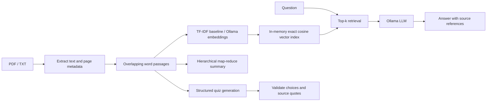

# Course Companion — Project 2

An educational assistant for PDF/TXT courses: three summary lengths, multiple-choice quizzes with corrections and difficulty levels, and a retrieval-augmented chatbot with passage citations.

## Run on Windows

Use Python 3.11 or 3.12. From this folder:

```powershell
python -m venv .venv
.venv\Scripts\python.exe -m pip install -r requirements.txt
.venv\Scripts\python.exe -m streamlit run app.py
```

Open the local address printed by Streamlit. The default **Offline preview** works without a language model: it provides retrieved excerpts and extractive summary previews. It does not generate quizzes or LLM answers.

If this workspace already has its prepared `.venv`, run just the last command. The bundled Codex Python may lack `ensurepip`; a normal Python installation is recommended for reproducing the standard setup.

## Enable the full LLM pipeline

Install [Ollama](https://ollama.com/download), then run:

```powershell
ollama pull qwen2.5:3b
ollama pull nomic-embed-text
```

Ollama must be running at `http://localhost:11434` (run `ollama serve` if necessary). In the sidebar, select **Ollama LLM** and **Semantic embeddings (Ollama)**. Model names and server address are editable. First model downloads require internet and disk space; model speed depends on your hardware. No paid API key is required.

Use **Check Ollama connection** in the sidebar to verify the server and selected models. **TF-IDF baseline** needs only the language model; `nomic-embed-text` is required only for semantic retrieval. Connection errors, missing models, and slow responses have separate messages with corrective steps. Without an available language model, quiz requests can return explicitly labeled source-completion practice instead of LLM questions.

After updating Python modules, restart the Streamlit process (Ctrl+C, then run the launch command again) if the app still uses old code. A browser refresh alone does not always clear imported Python modules. Restarting clears session uploads, so upload your course again afterward.

Start with the included original English NLP teaching sample, then upload real course PDFs or UTF-8 text. PDF page numbers are preserved. Image-only PDFs require OCR beforehand; figure/equation understanding is outside this prototype's scope. Use an embedding model appropriate to your corpus language; the included sample and suggested embedding model are intended for English.

## Architecture



- `study_assistant/corpus.py`: extraction, stable passage IDs, page-preserving chunking.
- `retrieval.py`: normalized vectors and exact cosine search. The lexical baseline removes common French/English function words and adds word-prefix features (weight 0.8) for simple inflections. Semantic mode combines dense cosine (45%) with lexical cosine (55%) to retain exact terminology; query-embedding failures use lexical search. These fixed demo weights are not claimed to be optimal. Dense embeddings require Ollama. This small-corpus prototype uses a session-local NumPy index rather than a persistent vector database.
- `llm.py`: Ollama chat, structured-output schema, and embedding HTTP client.
- `services.py`: grounded Q&A, bounded hierarchical summarization, and quiz validation.
- `app.py`: Streamlit interface, session state, source viewing, quiz scoring, summary download.
- `evaluate.py`: retrieval evaluation on the small synthetic test set.

Numbered section headings are detected before word chunking; overlap stays within a section and PDF page. Unnumbered text uses page-local word windows. All passages are processed during LLM summarization. Each summary stage returns structured text and source IDs, validated against that stage's input evidence. The app renders citations itself, and a merge can only cite references retained in its input notes. Invalid summary output gets one correction attempt.

Source IDs are replaced by short temporary aliases inside model requests and resolved by Python before display. Summary notes are deduplicated before checking a minimum amount of distinct text appropriate to the requested length and corpus size. A repeated paragraph cannot satisfy the minimum for a Detailed summary. These checks improve output structure; they do not establish semantic coverage or factual entailment.

Quiz evidence is bounded to 32 distinct source cards spread across the course. The model selects one card ID per question; Python attaches the card's immutable quote/source pair. The model never copies quotes or source IDs. Requests are split into batches of at most three questions. Valid individual questions survive a partial batch failure. There is at most one extra repair batch beyond the normal batch count (two to four model calls, depending on quiz size); remaining items use literal source-completion practice with four distinct choices, clearly labeled as fallback recall exercises rather than the requested LLM difficulty. Insufficient corpus material produces an actionable message, never fabricated questions. A failed regeneration preserves the prior quiz and corrections.

Chat uses structured source references too. A model failure returns labeled retrieved evidence. Summary generation failure returns labeled extracts. These are useful degraded modes, not claims of successful LLM generation. Chat history is displayed, but each question is retrieved and answered independently; use self-contained questions.

## Verification and experiments

```powershell
.venv\Scripts\python.exe -m unittest discover -s tests -v
.venv\Scripts\python.exe evaluate.py
.venv\Scripts\python.exe evaluate.py --chunk-size 120 --overlap 20 --top-k 2
.venv\Scripts\python.exe evaluate.py --semantic
.venv\Scripts\python.exe -m scripts.acceptance --course "path\to\course.pdf" --semantic
```

Evaluation writes `output/evaluation.json` with hit rate at k, reciprocal rank, latency, settings, and individual results. It does not call the generator or measure answer quality. The tiny original sample and its test questions are smoke fixtures, not scientific evidence of real-course performance. Prepare independently annotated real-course questions before making report claims.

The live acceptance runner repeats three-question quizzes, tests all difficulties and eight questions, generates each summary length, builds an index, and exercises course and out-of-scope chat. It records actual outputs, durations, and whether fallback was used in `output/acceptance.json`. Identical intermediate summary operations are cached during this check; final summaries at each length are separate model calls. Test statuses validate availability/structure, not factual or pedagogical correctness.

## Project 2 requirement mapping

| Requirement | Implementation / verification |
| --- | --- |
| PDF and text upload | Streamlit upload; extraction, scanned-PDF rejection, page metadata |
| Short, medium, detailed summaries | Full-course hierarchical generation; source validation; three separate output lengths |
| Multiple-choice quizzes and expected answers | Four choices, correct answer, explanation, source; grading and JSON export |
| Adjustable difficulty | Easy / Medium / Hard LLM instructions; fallback explicitly labeled recall |
| RAG chatbot with passage citations | TF-IDF baseline or dense Ollama vectors, cosine retrieval, structured generation |
| Section segmentation and long-document handling | Numbered-heading boundaries, bounded overlapping chunks, batched embeddings and hierarchical summaries |
| Student web interface | Chat, summary, quiz and source-library tabs |
| Summary/quiz examples for several documents | Reproducible live runner and included sample; collect outputs for your final corpus |
| Qualitative evaluation | Requires student/teacher review; structural tests cannot fulfill this requirement |
| Report PDF and GitHub delivery | Still require the final report and publication; not represented as complete |

Citation checks verify reference IDs, not semantic entailment. Quiz checks verify structure and literal source quotes, not whether the chosen answer is correct. Manually review outputs for fidelity and ambiguity. Retrieval thresholds are configurable similarity cutoffs, not calibrated confidence. Lexical overlap or semantic similarity can retrieve irrelevant evidence; an out-of-scope query is not guaranteed to be rejected.

The interface and summary downloads show document names and PDF page numbers instead of internal passage IDs. Multiple references on the same page are deduplicated. Quiz evidence is available in an expandable excerpt. PDF extraction removes recurring lines in page margins and standalone margin page numbers; it retains body content and original PDF page numbering. This heuristic does not repair every PDF layout or broken word.

## Data handling and limitations

Uploads and indexes live in Streamlit session memory; the app does not write them to disk. Model requests send evidence to the configured Ollama server. Extraction supports text, not OCR. The prototype limits each file to 20 MB and the collection to 1,500 passages. It does not implement authentication, durable document storage, streaming generation, or concurrent model scheduling. Do not expose the server publicly without additional deployment work.

## Remaining academic deliverables

1. Select a real course corpus and record provenance and permission to use it.
2. Evaluate lexical versus semantic retrieval, chunk sizes, overlap, and top-k on independently labeled questions.
3. Review summary fidelity and quiz correctness/difficulty with a rubric.
4. Capture real LLM dialogues, summaries, and corrected quizzes, including failure cases.
5. Write the final PDF report with architecture, technical choices, measured results, limitations, and repository URL.
6. Publish the reviewed source to your GitHub repository.

The implementation has not been published and no final experiment results or report are fabricated.

## API references

- [Streamlit upload widget](https://docs.streamlit.io/develop/api-reference/widgets/st.file_uploader)
- [Streamlit chat input](https://docs.streamlit.io/develop/api-reference/chat/st.chat_input)
- [Ollama API](https://docs.ollama.com/api)
- [Ollama structured outputs](https://ollama.com/blog/structured-outputs)
